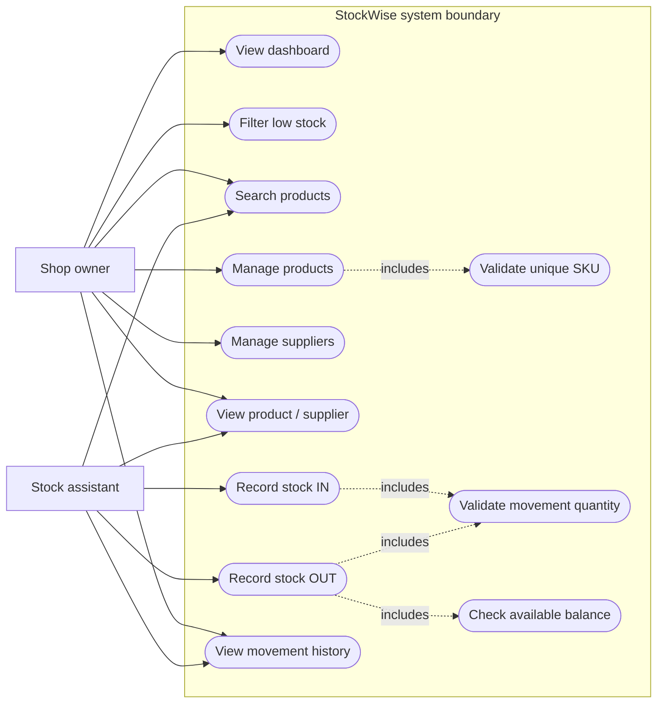
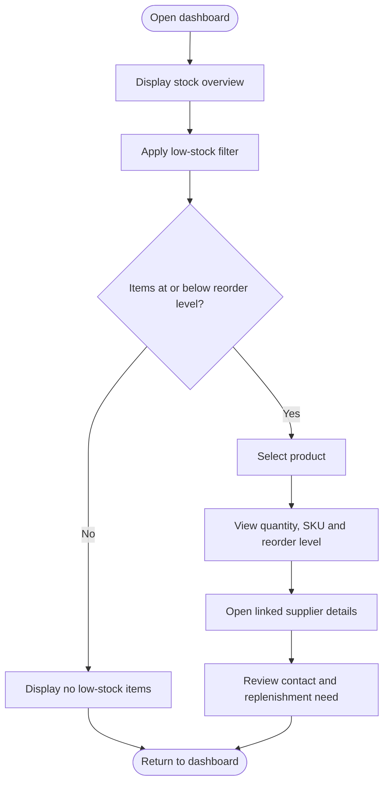
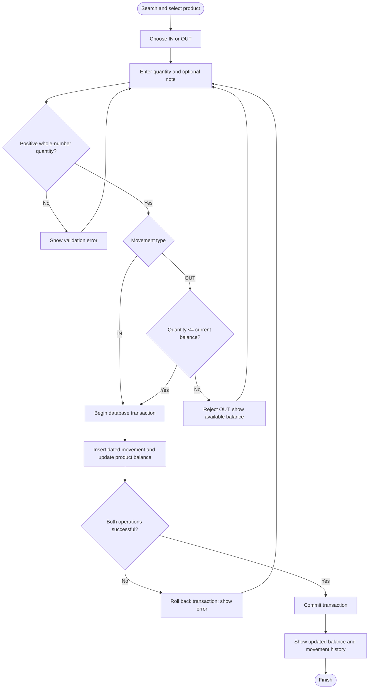
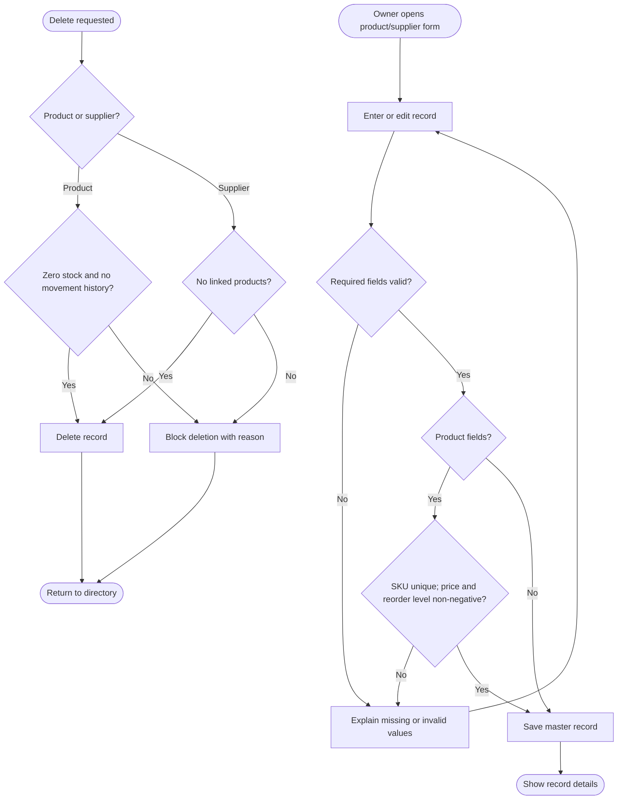
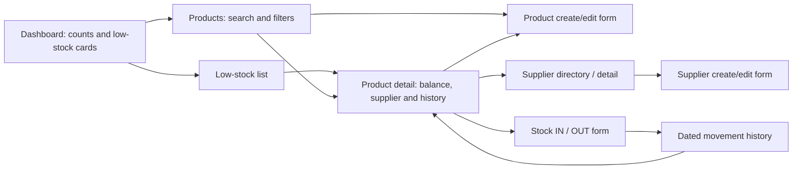

# StockWise — editable Sprint 2 design diagrams

These diagrams are **editable Mermaid source** committed to the repository, complementing the full editable `.drawio` source supplied in the local Sprint 2 package. GitHub renders Mermaid in Markdown. Diagrams illustrate proposed requirements, not verified implementation.

## D1. Use-case / actor relationship diagram



**Traceability:** US-01–US-23. The master-data edit/delete privileges are proposed for the owner; formal authentication is outside the verified Sprint 2 implementation.

## D2. Owner low-stock review flow



**Stories:** US-01–04, US-09, US-13.

## D3. Assistant stock movement and validation flow



**Stories:** US-14–20, US-22. Transactional integrity is a requirement, not an assertion that a MySQL transaction is implemented.

## D4. Master-data validation and deletion flow



**Stories:** US-05–13, US-21, US-23.

## D5. UI navigation / wireframe map



**Screen inventory:** dashboard, products list, product form/detail, supplier list/form, movement entry and movement history. Visual wireframe images are embedded in the accompanying Word/PDF report.

## D6. Sequence view of atomic stock update

```mermaid
sequenceDiagram
  actor Assistant
  participant UI as Pug UI
  participant API as Express/Node.js
  participant DB as MySQL
  Assistant->>UI: Enter stock IN/OUT
  UI->>API: Submit product, type, quantity, note
  API->>API: Validate positive integer and request
  API->>DB: BEGIN; lock selected product
  DB-->>API: Current balance
  alt Invalid OUT quantity
    API->>DB: ROLLBACK
    API-->>UI: Validation error
  else Valid movement
    API->>DB: INSERT movement; UPDATE balance
    alt Database error
      API->>DB: ROLLBACK
      API-->>UI: Error, no partial change
    else Success
      API->>DB: COMMIT
      API-->>UI: New balance and confirmation
    end
  end
```

**Note:** This is a proposed sequence, not tested application code.

[Submission report](SPRINT2_SUBMISSION_REPORT.md) · [Verified issue register](SPRINT2_GITHUB_VERIFICATION.md) · [Design index](SPRINT2_DESIGN_INDEX.md)
