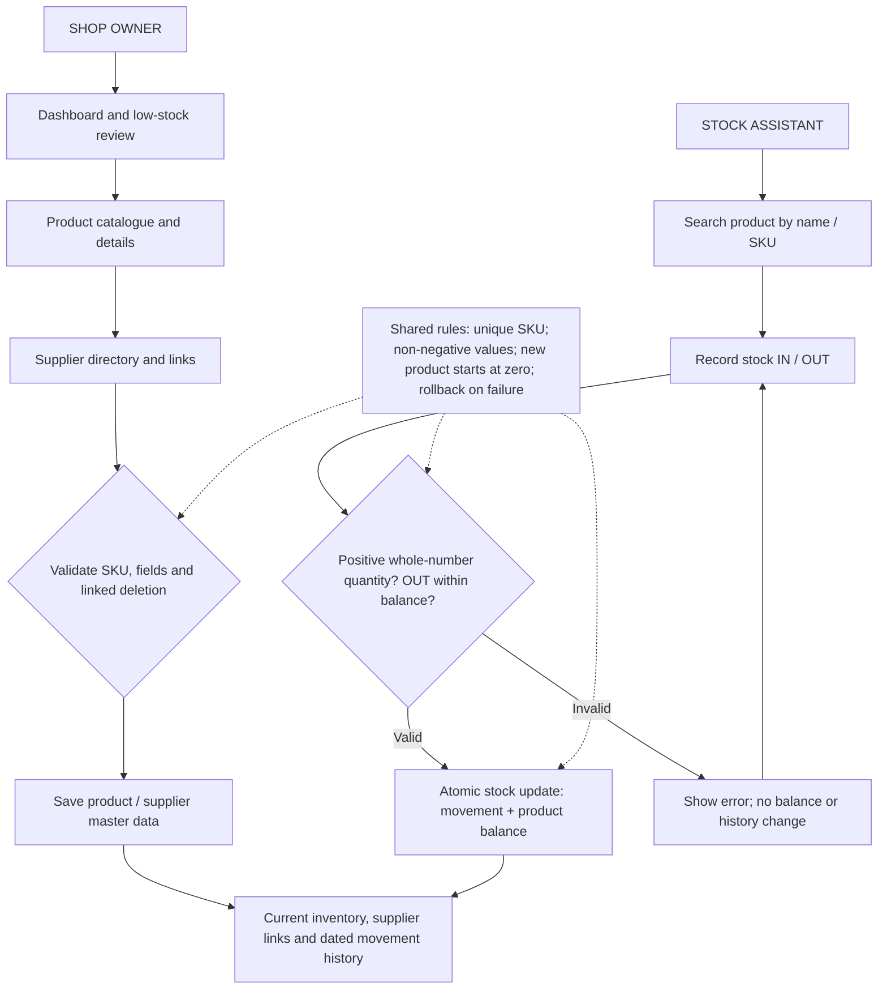

# StockWise — one integrated Sprint 2 diagram

This page contains **one** editable Mermaid diagram of the complete requirements and workflow, corresponding to the [single-page editable Draw.io file](StockWise_Sprint2_Repo_Editable_Diagrams.drawio). It includes the shop owner, stock assistant, key screens, validation, supplier/product updates, atomic stock movements and movement history. The diagram is a proposed design, not implementation evidence.

The accompanying Word/PDF report includes the screen specification, acceptance criteria, story-to-screen traceability, user flows and validation details in text and tables. All user stories and task assignments are linked from the [submission report](SPRINT2_SUBMISSION_REPORT.md).
