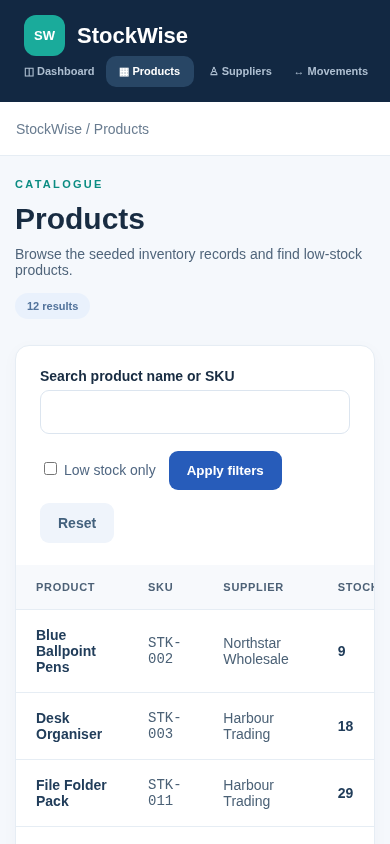
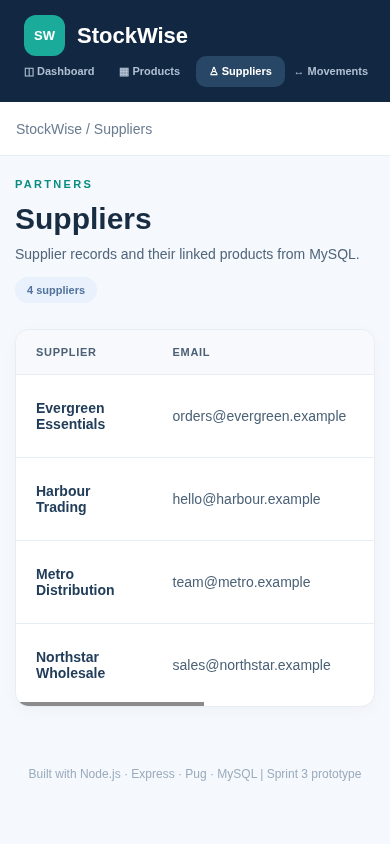
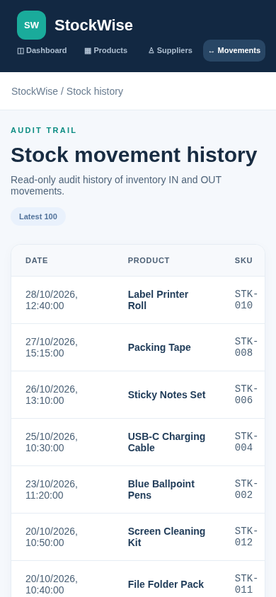
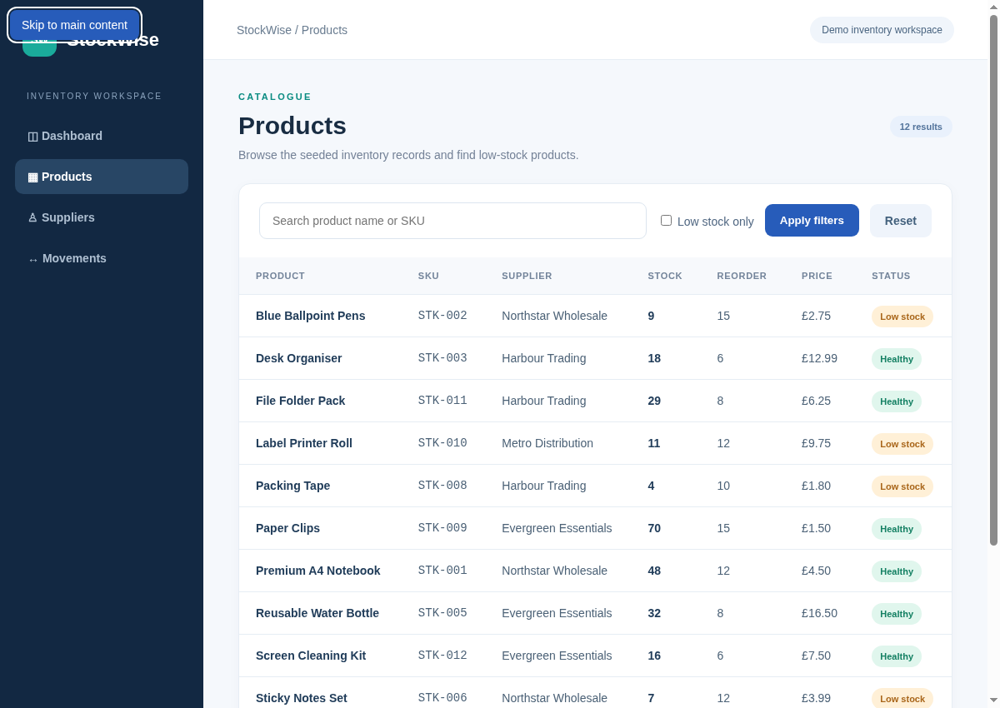
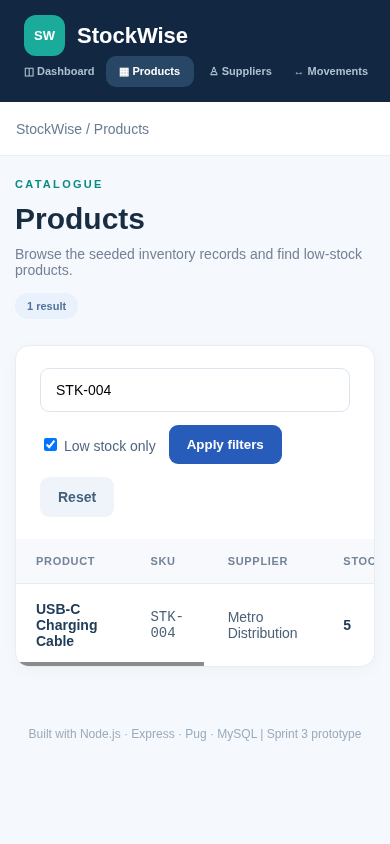
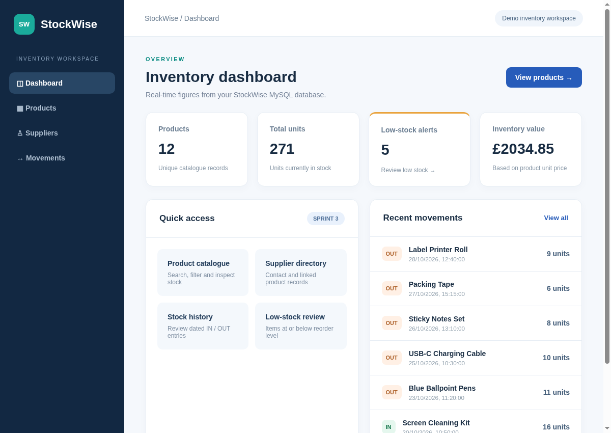
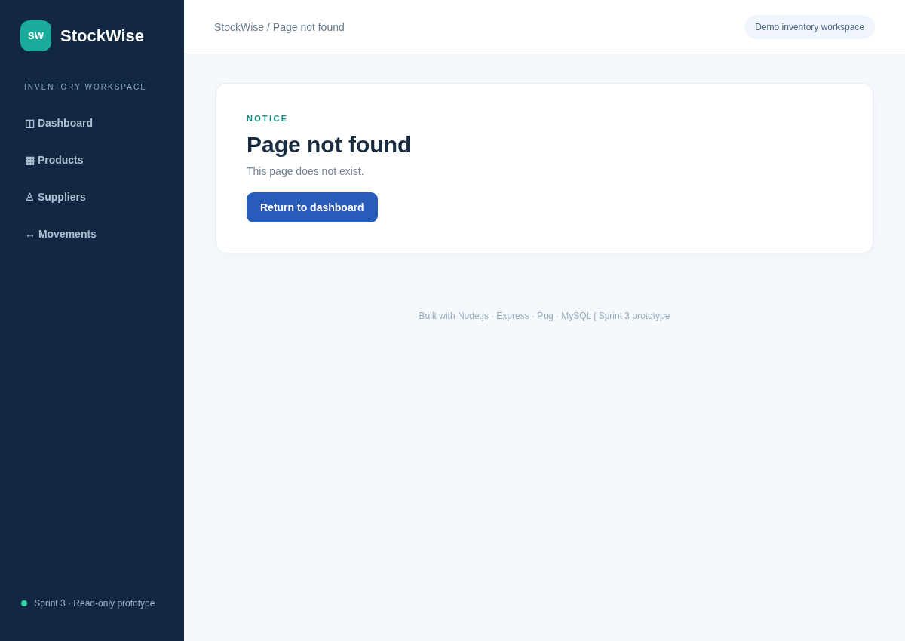

# StockWise — Sprint 3 final evidence index (24 November 2026)

> **Status:** evidence pack assembled, **not final sign-off**. This index is an AI-assisted compilation of existing repository evidence. Four individual draft pull requests are open, none merged; original member review and Scrum board status have not been independently verified as completed. **Do not mark Done solely because this page exists.**

## Core submission links

| Evidence | Verified URL | Status |
|---|---|---|
| Project repository | [StockWise code](https://github.com/harsh-patel1408/StockWise-Inventory-Management-System) | Available |
| Scrum board | [Harsh's Project 1](https://github.com/users/harsh-patel1408/projects/1) | URL in existing Sprint 2 submission report; **live board columns not verified** through this connection |
| Sprint 3 issue list | [Sprint 3 assigned tasks](https://github.com/harsh-patel1408/StockWise-Inventory-Management-System/issues?q=is%3Aissue+label%3A%22Sprint+3%22) | All #61–#69 still open at audit |
| Sprint 3 pull requests | [Team PR list](https://github.com/harsh-patel1408/StockWise-Inventory-Management-System/pulls) | Four draft PRs; none merged |
| Database automated testing | [MySQL CI run #2 — succeeded](https://github.com/harsh-patel1408/StockWise-Inventory-Management-System/actions/runs/45356985387) | Passed after test query alias fix |
| Original local-test record | [31 October local verification](https://github.com/harsh-patel1408/StockWise-Inventory-Management-System/blob/main/docs/SPRINT3_LOCAL_TEST_RESULTS_2026-10-31.md) | Separately tested code; distinguish from root scaffold |

## Member-specific pull requests

| Contributor/account | Assigned work | Actual GitHub artifact | Status |
|---|---|---|---|
| Harsh — `harsh-patel1408` | #61 Express/Pug setup, #65 DB-backed pages, #69 handover | [PR #70: backend verification](https://github.com/harsh-patel1408/StockWise-Inventory-Management-System/pull/70) | Draft; unmerged |
| Aavash — `aavashtuladharku-git` | #64 templates, #68 integration/demo | [PR #71: frontend demo](https://github.com/harsh-patel1408/StockWise-Inventory-Management-System/pull/71) | Draft; unmerged |
| Kunjan — `kunjan130` | #63 responsive design, #67 prototype test evidence | [PR #72: UX smoke tests](https://github.com/harsh-patel1408/StockWise-Inventory-Management-System/pull/72) | Draft; unmerged |
| Vinaybad — `vinaybadavath123` | #62 schema/seed review, #66 database integrity | [PR #73: MySQL verification](https://github.com/harsh-patel1408/StockWise-Inventory-Management-System/pull/73) | Draft; CI passed; unmerged |

> The schema and seed at the repository root predate Vinay's PR and should not be attributed as original Vinay commits. The PRs were prepared with AI assistance via the members' connected accounts; further authentic review, approval, and personal contributions must be recorded by the team.

## Real screenshot evidence from the PR branches

The images below were committed in the respective PR branches; these are **actual project screenshots**, not simulated board screenshots. Click any image or caption to open its GitHub source.

### Dashboard — desktop (Kunjan, PR #72)

### Mobile products — low stock / responsive UI (Kunjan, PR #72)

### Mobile suppliers (Kunjan, PR #72)

### Mobile movement history (Kunjan, PR #72)

### Frontend keyboard focus (Aavash, PR #71)

### Mobile filtered products (Aavash, PR #71)

### Backend dashboard (Harsh, PR #70)

### Not-found / 404 page (Harsh, PR #70)

## Recorded testing (with provenance)

- Tested **local prototype in the team branches** (not the root scaffold): 4 suppliers, 12 products, 17 movements, 5 low-stock items; see [Kunjan's smoke-test log](https://github.com/harsh-patel1408/StockWise-Inventory-Management-System/blob/4b334d34de2d6e39e0a2f6f347b6f0509dc6d4d8/docs/SPRINT3_UX_SMOKE_TESTS_2026-11-24.md), [Aavash's demo log](https://github.com/harsh-patel1408/StockWise-Inventory-Management-System/blob/3ac274878934a51c54a9baf19ac8251c43ee9945/docs/SPRINT3_FRONTEND_DEMO_2026-11-24.md), and [Harsh's backend log](https://github.com/harsh-patel1408/StockWise-Inventory-Management-System/blob/d785afe86d6d2d70972c398cc5b36ab69185d374/docs/SPRINT3_BACKEND_VERIFICATION_2026-11-24.md).
- **Root database**: 3 suppliers, 8 products, 7 movements, 4 low-stock products; Vinay's [MySQL CI run #2](https://github.com/harsh-patel1408/StockWise-Inventory-Management-System/actions/runs/45356985387) succeeded after a failure in run #1. The passing run imported the schema and seed twice and ran source and live MySQL assertions.
- The root demo and local-tested prototype use **different schemas / sample datasets**. Do not describe the root MySQL CI run as testing the 12-product app.
- No CI workflow proves the four draft PRs have been integrated together.

## Screenshot of live Scrum board — still to capture

[**Open actual Scrum project board**](https://github.com/users/harsh-patel1408/projects/1) and capture a real screenshot showing columns, issue cards, and current date after authenticated board access. This GitHub connection can verify the board **link** from repository documentation, but cannot view or capture the private/authenticated board UI or confirm card movements. No board screenshot is manufactured here.

## Outstanding sign-off checklist

- [ ] Team reviews all four PRs and validates contributions.
- [ ] Resolve integration conflicts, test chosen final prototype, and merge PRs.
- [ ] Update the actual GitHub Projects board cards based on verified work.
- [ ] Capture a real screenshot of the final Projects board after its cards are updated.
- [ ] Record a complete end-to-end demo video or screenshots of the **integrated** version (not separate PRs).
- [ ] Confirm final submission format, deadline, and designated upload link.

**Evidence assembled:** 24 November 2026. **Acknowledgement:** AI-assisted compilation and implementation support, with source-specific team demonstrations as linked above.
